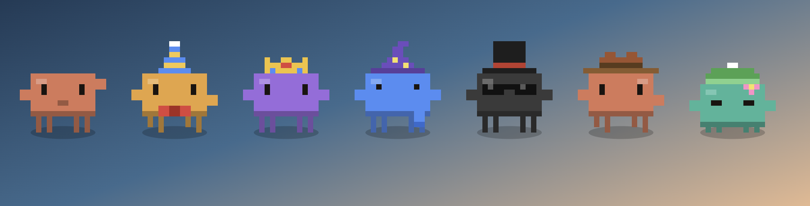
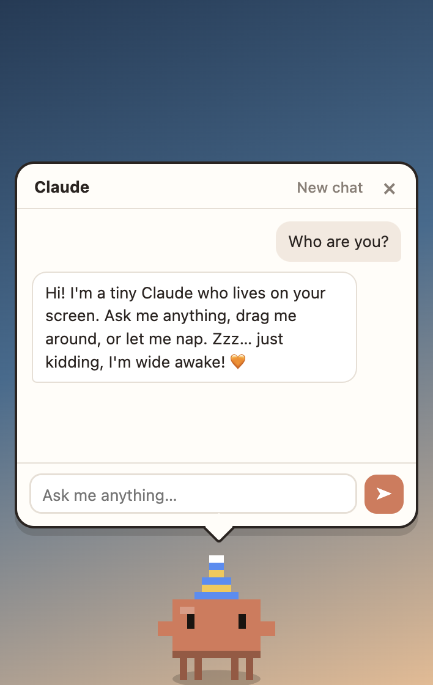
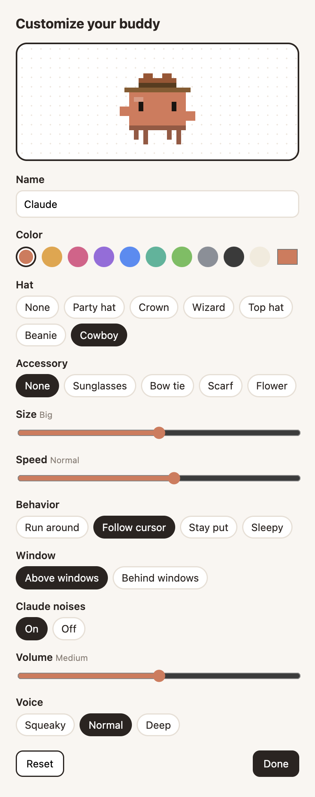

<h1 align="center">Claude Buddy</h1>

<p align="center"><b>A tiny pixel-art Claude who lives on your screen, runs around, and answers your prompts.</b><br>
Click him to chat · drag him around · dress him up · Mac, Windows and Linux</p>

<p align="center">
<a href="https://github.com/Hydrocarbon-Forge/claude-buddy/forks"></a>
<a href="https://github.com/Hydrocarbon-Forge/claude-buddy/watchers"></a>
<a href="https://github.com/Hydrocarbon-Forge/claude-buddy/issues"></a>
<a href="https://github.com/Hydrocarbon-Forge/claude-buddy/pulls"></a>
<a href="https://github.com/Hydrocarbon-Forge/claude-buddy/commits"></a>
<a href="https://github.com/Hydrocarbon-Forge/claude-buddy/graphs/contributors"></a>
<a href="https://github.com/Hydrocarbon-Forge/claude-buddy"></a>
<a href="https://github.com/Hydrocarbon-Forge/claude-buddy"></a>
<a href="https://github.com/Hydrocarbon-Forge/claude-buddy"></a>
<a href="https://github.com/Hydrocarbon-Forge/claude-buddy/releases"></a>
<a href="https://github.com/Hydrocarbon-Forge/claude-buddy/blob/main/LICENSE"></a>
</p>

<!-- badges:start -->
<p align="center">
<a href="https://github.com/Hydrocarbon-Forge/claude-buddy/releases/latest"></a>
<a href="https://github.com/Hydrocarbon-Forge/claude-buddy/releases"></a>
<a href="LICENSE"></a>

</p>
<p align="center">


</p>
<p align="center">


</p>
<p align="center">


</p>
<!-- badges:end -->

<p align="center">
<a href="#download">Download</a> ·
<a href="#what-he-does">What he does</a> ·
<a href="#customize-him">Customize</a> ·
<a href="#run-from-source">Run from source</a> ·
<a href="#how-it-works">How it works</a>
</p>

<p align="center"></p>

## What he does



Claude Buddy is a little Claude who wanders around on top of your desktop. Click him and a speech bubble pops up. Type anything and he answers, streaming the reply in with a little babble. Follow-up questions remember the conversation.

- 💬 **Chat:** click him, type, press Enter. Shift+Enter makes a new line. Esc closes the bubble.
- 🏃 **Roams your screen:** he walks, runs, waves, looks around and naps.
- 🖱️ **Follow-cursor mode:** he trots after your mouse and stops right beside it.
- ✋ **Drag him** anywhere, even onto another monitor.
- 🔊 **Claude noises:** soft made-up voice sounds: a curious "hm?" when you close the chat by clicking him, a cheerful "hi!" when he waves, "whoa!" when picked up, "oof" when put down, "hmmm" when you send a message, a "ding" when an answer lands while the chat is closed, idle chirps, babble while he answers, and little snores.
- 🪟 **Above or behind windows:** keep him on top of your other windows, or let them cover him.
- 👻 **Stays out of your way:** clicks pass straight through everywhere except him and his bubble (not on Linux; see Notes).
- 🚪 **Not a background app:** quit from his right-click menu or the tray/menu-bar icon. On a Mac, Cmd+Q also works.

<br clear="right">

## Download

Grab the latest from **[Releases](https://github.com/Hydrocarbon-Forge/claude-buddy/releases/latest)**:

| Computer | File | First time you open it |
|---|---|---|
| Mac (Apple Silicon) | `Claude-Buddy-…-mac-arm64.dmg` | Right-click the app → **Open** (it isn't code-signed) |
| Windows | `Claude-Buddy-…-windows-setup.exe` | If SmartScreen warns: **More info** → **Run anyway** |
| Linux x64 | `Claude-Buddy-…-linux-x64.AppImage` | `chmod +x` the file, then run it |
| Linux ARM | `Claude-Buddy-…-linux-arm64.AppImage` | Same as above |

**He needs [Claude Code](https://claude.com/claude-code)** installed and signed in. Run this once in a terminal and follow the prompts:

```bash
claude
```

If you can chat with Claude in your terminal, your buddy can too. No API key required.

On Windows, Claude Code also needs [Git for Windows](https://git-scm.com).

## Customize him



Right-click him and choose **Customize…** Every change shows up live.

- **Name**, used in his bubble and in how he introduces himself
- **Color**: 10 presets or any color you like
- **Hat**: none, party hat, crown, wizard, top hat, beanie, cowboy
- **Accessory**: sunglasses, bow tie, scarf, flower
- **Size**: tiny to giant
- **Speed**: snail to zoomy
- **Behavior**: run around, follow cursor, stay put, sleepy
- **Window**: stay above your other windows, or behave like a normal window that they can cover
- **Noises**: on or off, volume, and a squeaky, normal or deep voice

His right-click menu also has **Talk to**, **Nap time / Wake up**, **Come here!**, **Follow my cursor**, **Stay above other windows**, **Noises**, **New conversation** and **Quit**.

<br clear="right">

## Run from source

You only need Node.js to run from source or build installers.

```bash
git clone https://github.com/Hydrocarbon-Forge/claude-buddy.git
```

```bash
cd claude-buddy
```

```bash
npm install
```

```bash
npm start
```

### Build the installers

Output goes to `dist/`. electron-builder can cross-build, so all three work from a Mac.

```bash
npm run dist:mac
```

```bash
npm run dist:win
```

```bash
npm run dist:linux
```

To regenerate the screenshots in `docs/`:

```bash
npx electron scripts/shots.js
```

## How it works

| Piece | File | What it does |
|---|---|---|
| Main process | [`main.js`](main.js) | Transparent, frameless window; tray and menus; watches the cursor to switch click-through on and off; runs `claude -p` and streams the reply back |
| Pixel art | [`sprite.js`](sprite.js) | Draws him rectangle by rectangle: 7 poses, 6 hats, 4 accessories, any color |
| Buddy | [`renderer/buddy.js`](renderer/buddy.js) | Wandering, following, dragging, the chat bubble and the typewriter reply |
| Voice | [`renderer/sound.js`](renderer/sound.js) | Web Audio voice: a buzzy tone through vowel filters, so every noise is made live |
| Customize | [`renderer/settings.js`](renderer/settings.js) | The settings window with a live preview |
| Icon | [`scripts/make-icon.js`](scripts/make-icon.js) | Builds the app icon from the sprite with a hand-written PNG encoder |

Your prompts go to the `claude` command on your own computer, with its tools turned off and running in its own chat folder inside the app's data folder. He chats; he doesn't touch your files.

### Chat, limits and troubleshooting

- **Memory:** a conversation remembers earlier messages until you choose **New chat** (in the bubble, or in the right-click menu) or quit. Nothing is saved to disk.
- **One question at a time:** asking something new cancels the reply that's still coming in.
- **Time limit:** if a reply takes longer than three minutes, he stops and asks you to try again.
- **"I can't find Claude Code":** install Claude Code, run `claude` once in a terminal to sign in, then try again.
- **Settings file:** your choices are saved to a `settings.json` inside the app's data folder, so they survive restarts.
- **Second launch:** opening Claude Buddy while it's already running brings him home to the bottom of the screen.
- **Lost him?** Right-click the tray or menu-bar icon and choose **Come here!**

## Notes

- **Linux:** the see-through window needs a desktop compositor, which most desktops have. Linux can't pass clicks through windows, so the small box around him stays clickable. On Wayland he runs through XWayland so he can move his own window.
- **Windows:** if Claude Code was installed with npm, he finds it automatically. Claude Code also needs Git for Windows.

## License

[MIT](LICENSE). Claude Buddy is a fan-made toy and isn't affiliated with or endorsed by Anthropic.
